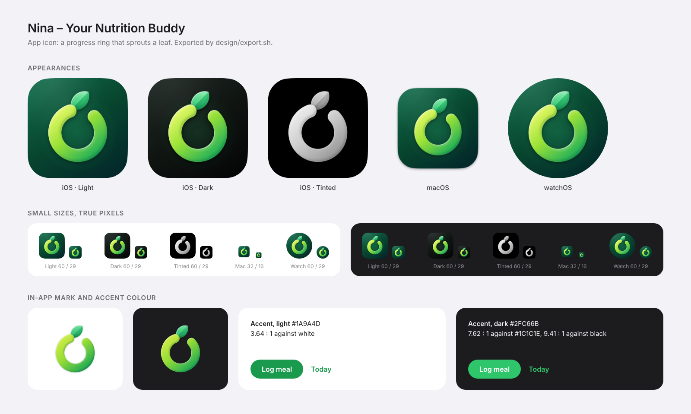

# Nina icon

A thick progress ring, 82 % closed like an Activity ring, whose end cap at the top sprouts a single
leaf, so the tracker you fill every day also reads as an apple. One glassy lime-to-green shape on a
deep forest-green ground, with no text, faces or cutlery.



## Colours

| Use | Hex |
|---|---|
| Background (light icon, Mac, watch) | `#0F6A48` → `#08452F` → `#03282A` (forest green → deep teal, top left → bottom right) |
| Background glow behind the ring | `#3BE08A` at 20 % (14 % on dark) |
| Ring gradient | `#E2F865` (lime) → `#9BE238` → `#21B05A` (green) |
| Leaf, sunlit half (base → tip) | `#2CC46C` → `#8DF0B2` |
| Leaf, shaded half (base → tip) | `#119752` → `#45D684` |
| Dark appearance background | `#1E2723` → `#101512` → `#050707` |
| Tinted appearance | the same glyph in luminance-matched greys (`#ECECEC` → `#9A9A9A` ring) on `#000000` |
| In-app mark (`mark.svg`) | the same glyph a shade deeper so it holds on white: ring `#CBEB45` → `#95DC35` → `#1FAA55`, leaf `#27BC66`/`#73E6A1` and `#0F9150`/`#3FCF7E` |
| **Accent, light** (AccentColor) | `#1A9A4D`, 3.64 : 1 against white |
| **Accent, dark** (AccentColor) | `#2FC66B`, 7.62 : 1 against `#1C1C1E`, 9.41 : 1 against black |

The accent is the ring's green (hue 144°), darkened until it passes 3 : 1 on white. It stays clearly
apart from the teal (`#13707F`, hue 188°), blue and amber of the sibling apps.

## Files

| File | What |
|---|---|
| `icon.svg` | iOS / iPadOS light (any) appearance, and the watchOS icon: 1024 × 1024, full bleed |
| `icon-dark.svg`, `icon-tinted.svg` | iOS dark and tinted appearances |
| `icon-mac.svg` | macOS: the same artwork in the 824 × 824 continuous-corner shape (radius 185.4) with a shadow |
| `mark.svg` | the glyph alone on transparent, for the welcome and About screens (`NinaMark` image set) |
| `render.js`, `export.sh` | renderer (Playwright / headless Chromium) and the export of every PNG |
| `icon-1024.png`, `icon-mac-1024.png`, `contact-sheet.png` | generated previews (README, Mac, review) |

All five SVGs draw the same glyph with the same coordinates (ring centre 512, 556, radius 234,
134 thick, open from −20° to 46°; leaf at `translate(447.94 319.57) rotate(44)`). Change it in all
of them together.

## Re-render

```bash
bash design/export.sh
```

Run it from the repo root. It needs node with Playwright (headless Chromium) and ImageMagick
(`magick` or `convert`). It rewrites the `AppIcon` sets of the app and the watch app, the `NinaMark`
image set and the previews in this folder. iOS and watch PNGs are written opaque (no alpha channel),
and the Mac sizes are downscaled from the 1024 render. With the same Chromium and ImageMagick versions,
a re-run writes byte-identical files, so only real changes show up in git.
